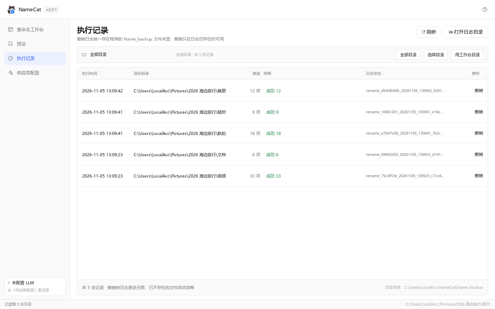
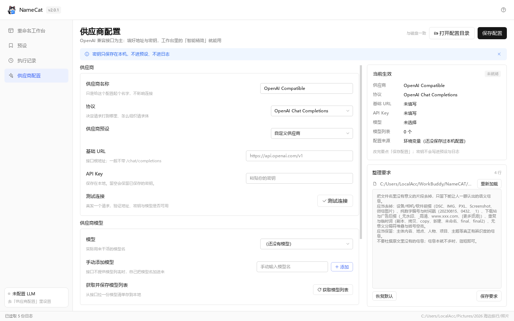

# NameCat

Windows 批量重命名工具。扫描文件 / 文件夹 / 图片 / 视频，用一条可排序的规则链算出新名字，**先预览、再落盘、全程可撤销**。

PySide6 桌面界面 + 可脚本化命令行，共用同一套引擎，行为完全一致。


`v2.0.0` · Windows · Python 3.15（引擎为 Rust 扩展）· 界面基于 PySide6 6.10

不想装 Python？Releases 里有免安装的 `NameCat.exe`（单文件，解压即用）。

---

## 三条底线

1. **预览显示的名字就是落盘的名字** —— 执行时直接用已算好的计划，绝不重算（LLM 不会被请求两遍，随机规则不会跑偏）。
2. **冲突项跳过、绝不覆盖** —— 批内重名、盘上占用、非法名字在校验阶段就标出来，勾一下就能排除。
3. **每一步都可撤销** —— 临时名中转处理链式改名与父子同时改名，任一步失败自动回滚；执行后写撤销日志，可整批还原。

## 功能

**扫描**
- 对象四类：文件 / 文件夹 / 图片 / 视频，可混合；图片、视频支持文件头魔数校验（扩展名骗不了它）
- 名称与扩展名过滤、只含 / 排除关键词；递归深度控制、隐藏项开关
- 排序十档：自然序 / 时间 / 大小 / 路径 / 倒序，**先排序再编号**
- 直接拖入文件与文件夹；工具栏的「选择目录…」选根目录，想「只要这几个文件」就把它们拖进预览卡

**规则链**
- **28 种规则**，自上而下依次作用（顺序即语义），可启停、上下移动、复制
- 每条规则可用「作用范围」限定到名字的某一段（某字符之前 / 之后、区间、第 N 次出现），并可勾选「不作用于扩展名」「保留分隔符」
- 六个分组：增删 / 切取 / 修饰 / 编号与序列 / 模板与规范化 / 智能
- 编号（起始值 / 步长 / 补零 / 编号范围 / 倒序 / 插入位置与锚点）全在「编号」一条里，链上没有第二个编号入口
- 「音视频文件序列化」把整名换成四位序号（每个文件夹各自从 0001 起、扩展名不变）
- 模板变量 `{n}` `{name}` `{ext}` `{date}` `{parent}` …，两种写法（`{var}` 与 `$Var`）都认

**校验与落盘**
- 两遍校验：名字语法（非法字符 / 保留名 / 尾点尾空格 / 超长）→ 批内重名 + 盘上占用
- 状态五档：待重命名 / 名称未变 / 冲突 / 无效 / 已跳过，原因写在行里
- 临时名中转：`A→B、B→C` 这类链式改名与父子目录同时改名都能正确落地
- 撤销日志统一存 `<程序目录>\Name_backup\`，**不往你的数据目录里塞垃圾**

**预设**
- 内置 4 个常用预设，自定义预设存为 JSON（不含路径与密钥），一键应用（规则链 + 扫描 / 编号选项一起套用）

**LLM 智能精简（可选）**
- 把 `IMG_20240601_拷贝(2)` 这类名字精简成可读短语；离线 / 没配密钥时自动跳过，其余规则照常工作

**命令行**
- 全部能力可脚本化；默认**只预览**，加 `--apply` 才落盘

## 界面

| 工作台 | 预设 |
|---|---|
|  |  |
| **执行记录** | **供应商配置** |
|  |  |

四个页面：**工作台**（扫描 → 规则链 → 预览 → 执行）、**预设**、**执行记录**（查看与撤销）、**供应商配置**（LLM 接入）。

工作台右上角的 ⤢ 把预览表放大到整页（`Esc` 还原）；规则多时列表在卡内滚动。

### 快捷键

| 键 | 动作 |
|---|---|
| `F5` | 重新扫描 |
| `Ctrl+Enter` | 按当前规则生成预览 |
| `Ctrl+1…4` | 切换四个页面 |
| `Esc` | 退出预览表的放大（⤢）视图 |

> 勾选预览行点左侧复选框；删除规则用规则行右侧的删除按钮。

## 快速开始

```bat
NameCat.vbs        :: 双击启动（无控制台，推荐）
namecat.bat        :: 带控制台启动，报错可直接看到
python main.py     :: 等价写法
```

需要 **Python 3.15**（引擎扩展按这个版本编译）与界面依赖：

```bat
py -3 -m pip install -r requirements.txt
py -3 rust_build.py      :: 构建引擎（Rust 扩展），只需在源码更新后跑一次
```

- **引擎是 Rust 写的**（`crates/`），`engine/*.py` 只是转发。源码运行前必须
  `rust_build.py` 构建出 `_vendor/namecat_py.*.pyd`，否则启动时报
  "引擎扩展没加载"。构建需要 [Rust 工具链](https://rustup.rs) 与 `maturin`：
  `py -3 -m pip install maturin`。
- **不想装 Rust / Python**：直接用 Releases 里的 `NameCat.exe`，引擎已经打在包里。
- 界面需要 PySide6（6.10+）；命令行与界面共用同一个引擎扩展，依赖一样。
- 只改界面 / 适配层（`ui/`、`adapters/`）时不必重建引擎；改 `crates/` 才需要。
- 界面字体使用**系统自带 UI 字体**（Windows 的 Microsoft YaHei UI 等），不随包分发字体文件。
- 双击没反应时看 `%TEMP%\NameCat_startup_error.log`；用 `namecat.bat` 启动可直接看到 traceback。
- 绿色版 exe 启动时弹出 **`Could not create temporary directory!`**：这是 PyInstaller 单文件模式的
  引导程序在报错 —— 它要先把自己解压到 `%TEMP%` 下再运行。说明当前账号的 `%TEMP%` 不可写
  （常见于企业策略、被安全软件锁住的临时目录、或用别的账号运行）。把 `TEMP` / `TMP`
  指向一个可写目录再启动即可（`set TEMP=%LOCALAPPDATA%\Temp` 后重新双击）。

## 命令行

```bat
:: 预览（默认不落盘）
python main.py preview D:\照片 --rule "template={n}" --width 3 --only image --recursive

:: 真正改名（写撤销日志）
python main.py rename D:\照片 --rule "case=lower" --rule "remove-after=-" --apply

:: 撤销、列出规则、列出预设
python main.py undo D:\照片
python main.py rules
python main.py presets
```

- `--only`：`file / dir / image / video / media / all`
- `--rule 名称=参数1=参数2`，可重复多条按顺序生效；`--rule "case=lower;sel=after;sep=-"` 限定作用范围
- 默认**只预览**，加 `--apply` 才落盘；`--csv` 导出预览结果；`--preset` 直接用预设文件（规则与扫描 / 编号选项一起生效，命令行显式参数优先）
- `preview` 子命令**不接受** `--apply`：只想看结果时不会误改文件
- 撤销失败会返回非 0 退出码（并写明是哪一项没还原），方便脚本判断

## 工作流与安全设计

```
扫描 ──► 编号 ──► 规则链算名 ──► 两遍校验 ──► 预览 ──► 执行 ──► 撤销日志
```

- 冲突项默认**跳过、不覆盖**；执行采用临时名迁移 + 失败回滚。
- 撤销按日志逐条还原（**父目录先还原**，多层嵌套也能完整复原）；目标已存在时跳过而不是覆盖。
- 扫描自动跳过 `Name_backup` 与旧版 `_rename_logs` 目录，不会把日志当文件改名。
- 每个目录保留最近 20 份撤销日志（总量上限 200），程序目录不可写时自动退回 `%APPDATA%\NameCat\Name_backup`。

## LLM 智能精简（可选）

在规则链里加一条「LLM 智能精简」即可，接入方式在「供应商配置」页配置：

- **供应商**：协议（OpenAI Chat Completions / OpenAI Responses / Anthropic Messages）、预设（自定义、OpenAI、DeepSeek、Xiaomi MiMo、OpenCode Go、本地 Ollama、离线替身）、基础 URL、API Key
- **模型**：手动添加，或一键「获取模型列表」从接口拉一份存到本地
- **高级**：模型列表 URL、自定义请求头（随每次请求发出）
- **测试连接**：真发一个请求验证地址 / 密钥 / 模型，报耗时与失败原因（401 / 404 / 连不上都说人话）

密钥**不回显**，单独存 `%APPDATA%\NameCat\llm_credential.dat`（Windows 用 DPAPI 加密，只有当前账号解得开）；地址、模型等非敏感项存 `llm_provider.json`。输入框留空表示沿用已保存的密钥。

整理要求在 `%APPDATA%\NameCat\llm_instruction.txt` 里自由编辑（同页右侧）。左下角的状态气泡显示真实连接状态与耗时；测试连接与拉模型列表都在后台线程跑，不卡界面。

命令行也认环境变量（界面保存过配置时以界面为准，命令行参数优先级最高）：

```bat
set NAMECAT_LLM_API_KEY=sk-...
set NAMECAT_LLM_BASE_URL=https://api.deepseek.com
set NAMECAT_LLM_MODEL=deepseek-chat
```

也认 `OPENAI_API_KEY` / `DEEPSEEK_API_KEY`。

## 数据与隐私

| 位置 | 内容 |
|---|---|
| `%APPDATA%\NameCat\` | 界面偏好、预设（**不含任何密钥**） |
| `%APPDATA%\NameCat\llm_provider.json` | LLM 地址 / 模型 / 请求头 |
| `%APPDATA%\NameCat\llm_credential.dat` | LLM 密钥（DPAPI 加密，不进仓库、不进日志） |
| `<程序目录>\Name_backup\rename_*.json` | 撤销日志（文件名带 8 位目录指纹，便于分开查） |

预设与撤销日志都不含密钥；日志里的路径是本机真实路径，`Name_backup/` 已列入 `.gitignore`，绝不入库。

## 开发

```
main.py                 入口：无参数开 GUI，其余走命令行
ui/                     桌面界面（PySide6）
  base.py                 设计令牌、字体、图标、基础控件
  window.py               顶栏 / 侧栏 / 页面栈 / 状态栏
  pages/                  工作台 / 预设 / 执行记录 / 供应商配置
adapters/               界面 ⇄ 引擎的唯一通道（FormState ⇄ 引擎参数）
engine/                 重命名引擎（纯标准库，无界面依赖）
  scan.py plan.py rules.py template.py context.py llm.py
  provider.py secrets.py
  common.py ops.py presets.py cli.py
workers/                后台任务（QRunnable + 线程池，信号回主线程）
verify/                 自检：run_tests.py（410 断言）、test_edges.py（边界与异常路径）、ui_smoke.py（界面冒烟）
docs/                   设计文档、设计稿与界面截图
```

**分层约定**：`ui/` 只调 `adapters.engine_adapter`，不直接碰 `engine/`；`engine/` 是纯逻辑、零 Qt 依赖，所以命令行与界面行为永远一致。改界面前先读 `docs/GUI_DESIGN_GUIDE.md`。

自检（改动后必跑）：

```bat
py -3 verify\run_tests.py     :: 引擎 + 端到端 + 回归（410 断言）
py -3 verify\test_edges.py    :: 边界与异常路径（190 断言 + 缺陷探针，见 docs\TEST_REPORT.md）
py -3 verify\ui_smoke.py      :: 界面交互冒烟（离屏，不需要显示器）
```

## 更新记录

### 2.0.0

**引擎整体由 Python 改写为 Rust**（12 个模块，PyO3 扩展）。对外接口逐个保持不变，
界面与命令行几乎没动 —— 2.0 的版本号是给引擎换的实现底座。

- **性能**：扫描 2000 个文件 50 → 30 ms（1.65×），"扫描 + 算名"整体 137 → 116 ms（1.18×）；
  算名、落盘、撤销与 Python 版持平 —— 这三段分别是跨语言边界、磁盘 I/O 主导。
  完整数据与口径见 `docs/TEST_REPORT.md` 第 8 节
- **一致性**：3170 项逐字段对拍（`_verify_tmp/p{2,3,4}_equiv.py`）确认与换壳前逐项一致；
  另有一道符号闸门盯着 12 个模块的 193 个公开符号，改坏接口会立刻红
- **发布链路**：`build_exe.py` 三道闸（扩展是否存在 / ABI 是否匹配 / 是否比源码旧），
  打包后自动跑一次"改名 → 撤销"自检 —— 窗口程序没有控制台，漏了引擎只表现为
  "双击没反应"，必须在这里拦住
- **体积**：exe 41.2 → **29.8 MB**（剔除 `opengl32sw.dll` 等用不到的二进制；
  老机器需要软件 OpenGL 时用 `--keep-opengl` 打回去）
- **源码运行**：需要 Python 3.15，并先 `py -3 rust_build.py` 构建引擎（见「快速开始」）

### 1.6.3

功能有效性与一致性审查后的修复，重点在「同一份配置在不同入口得到不同结果」：

- **修复（一致性）**：命令行 `--preset` 只读了规则、把预设里的扫描与编号选项丢掉了 —— 同一条内置预设在界面出 `0001.jpg`、在命令行出 `1.jpg`。现在两者同解（规则 + 扫描 + 编号一起套用），命令行显式参数优先
- **修复（数据安全）**：模板输出里带点时原扩展名会被吞掉（`template={parent}-{n}` 遇到父目录 `2024.10`，`photo.jpg` 变成 `2024.10-1`）。现在只有模板**原文**自己写了 `.md` 这类字面扩展名时才替换原扩展名
- **修复（数据安全）**：`A→B、B→C` 链式改名里若 B 的去向被盘上文件占住，A 仍判「待重命名」，执行必然失败（WinError 183）并把整批拖成「失败」。现在只把"确实会让位"的项算作腾出路径
- **修复（可达性）**：属性面板补上「不作用于扩展名」「第几次出现」「保留分隔符」三个开关；编号规则补「锚点字符」，选「锚点之前 / 之后」不再静默退回前缀
- **修复**：`extension` 填 `md`、`keep_after` 留空这类引擎本来就能处理的写法，不再被当成参数错误拦下，改为面板底部的橙色提示
- **修复**：取消勾选预览行后该行状态格不刷新（文字还写着"待重命名"，而底部"已跳过"已经 +1）
- **修复**：应用预设后「包含子文件夹 / 包含隐藏项」勾选框与预设不一致
- **修复**：LLM 请求失败时左下角气泡仍显示"已连接 · 平均 N ms"（状态上报写在 `finally` 里）
- **修复**：「执行记录」的结果列显示的是校验统计而非执行结果；日志新增 `exec` 段（schema 5）记录真实成败，老日志照常可读
- **修复**：`preview --apply` 真的会改名 —— 该子命令不再接受 `--apply`
- **改进**：模板输入框的 tooltip 列出全部可用变量与示例值（原来那句"点击右侧按钮打开模板编辑器"从未实现）
- **改进**：四条切取规则的「分隔符留空」统一为按长度对半截断（`keep_before` 之前是原样返回，同族四条规则出现过三种行为）
- **改进**：编辑靠后的规则时，规则列表不再跳回顶部
- **文档**：「音译」更名为「转写（转拉丁字母）」并注明中文不做拼音转换；README 去掉并不存在的「拖动排序」「预设导入导出」，断言数与 Python 版本对齐

### 1.6.2

全面测试（`docs/TEST_REPORT.md`）后的缺陷修复，**4 个 P0 全部修掉**：

- **修复（数据安全）**：链式改名在落位阶段失败时，已落位的文件会被留在 `__nk_tmp_*` 临时名下、原名丢失，界面还报"已回滚"。现在统一退回原名，失败原因也不再被"已回滚"覆盖
- **修复（数据安全）**：规则把名字主干删空时，原来会把 `abc.txt` 改成没有名字的 `.txt` 并真的落盘；现在判"无效：名字不能为空（只剩扩展名）"，文件夹删空也从"名称未变"改为明确的"规则把名字删空了"
- **修复**：作用范围选「到某字符止（含）」时改名结果错乱（`case=upper` 会把 `show-2026-10-19` 变成 `show-SHOW-`），根因是拼回时用了"某字符之后"的公式
- **修复**：从两个盘符各拖一个文件夹进来时，预览直接抛 `ValueError`；现在跨盘对象不做父路径映射，并且**只收拖进来的那几个**（不再顺手把父目录里其它条目拉进列表）
- **修复**：撤销只成功一半后日志永远删不掉、每次撤销都报"未完成"。现在已不存在的目标算跳过、失败项写回日志、该做的做完即删，重复撤销幂等
- **修复**：撤销日志写不进去时仍然报"已重命名 N 项"成功 —— 现在明确提示"本次改名无法撤销"
- **修复**：`main.py undo --log` 指向不存在/损坏的日志时抛 traceback；`--csv` 指向不可写路径同样抛栈 —— 都改为一句人话 + 非 0 退出码
- **修复**：一份结构异常的日志会让「执行记录」整页读取失败（好日志也看不到）；现在只跳过那一份
- **修复**：应用预设会清空当前目录和已扫结果，现在保住目录并按新预设自动重扫
- **修复**：供应商配置页切走再切回会静默清掉刚粘贴、还没保存的密钥
- **修复**：`--step 0` 不再让整批拿到同一个号码（回落成 1 并提示）；补零宽度 / 随机串长度加上限（64），避免一个对象就撑出几十 MB 的名字
- **修复**：本机装了系统代理时，`127.0.0.1` 的请求也会被塞给代理，本地 Ollama 报的错变成代理的 502 —— 现在回环地址一律绕过代理
- **修复**：`normalize()` 对 `extras=None`、`selector=3` 这类程序化脏输入会崩；未知规则类型现在会在界面上标出来，而不是静默变成空规则
- **新增**：`main.py leftovers <目录>` 列出执行被中断后遗留的临时名文件（有残留时返回 1）
- **新增**：`verify/test_edges.py` —— 190 条边界与异常路径断言 + 16 个缺陷探针（修好会自动变绿）
- 顺手对齐文档：README 里两条并不存在的快捷键（空格/双击勾选、`Delete` 删规则）已删除

### 1.6.0

- **新规则：简繁转换**（`zhconv`）—— 逐字转换 4000+ 汉字，方向可选「简体→繁体 / 繁体→简体」；命令行别名 `zh` / `s2t` / `t2s` / `简繁`。规则数 27 → 28
- **界面：去掉所有横幅**，页内提示统一并入工具栏右侧的状态槽，按语气给胶囊底色（灰 / 蓝 + 转动图标 / 绿勾 / 橙 / 红），扫描完成 5 秒后淡回默认态
- **界面：执行结果不再打印撤销日志路径**，要看 Log 去「执行记录」页
- **发布：Windows 单文件 exe**（`build_exe.py` 一键打包），Releases 直接下载，无需 Python 环境

### 1.5.2

- 修正 1.5.1 的「选择…」按钮：Qt 的文件对话框在 Windows 上无法同时选文件和文件夹，改回**只选文件夹**的「选择目录…」
- 「只要这几个文件」的用法改用拖放：把文件拖进预览卡即可（与按钮共用同一套逻辑）

### 1.5.1

- 工具栏的「选择目录」与「扫描对象…」合并成一个按钮（1.5.2 已修正为只选文件夹）
- 修正 README 里两条并不存在的快捷键（`Ctrl+O` / `Ctrl+S`）

### 1.5.0

- **版本号统一**为 1.5.0，界面 / 命令行 / 预设元数据 / 撤销日志全部一致
- **修复**：扫描不再把 `Name_backup` 里的撤销日志当成改名对象
- **修复**：撤销失败现在会正确报错（`main.py undo` 返回非 0），不再误报成功
- **修复**：手改坏的预设 JSON 不再抛异常，能读回来的规则照常使用
- **字体**：移除随包字体，改用系统自带 UI 字体；小字号不再加粗，密集汉字更清晰
- **LLM 供应商配置**：三种协议、七个预设、DPAPI 密钥保管、后台测连通

---

NameCat 2.0.0 · 引擎 Rust · 界面基于 PySide6 6.10 · 设计稿见 `docs/design-preview/boards.png`
