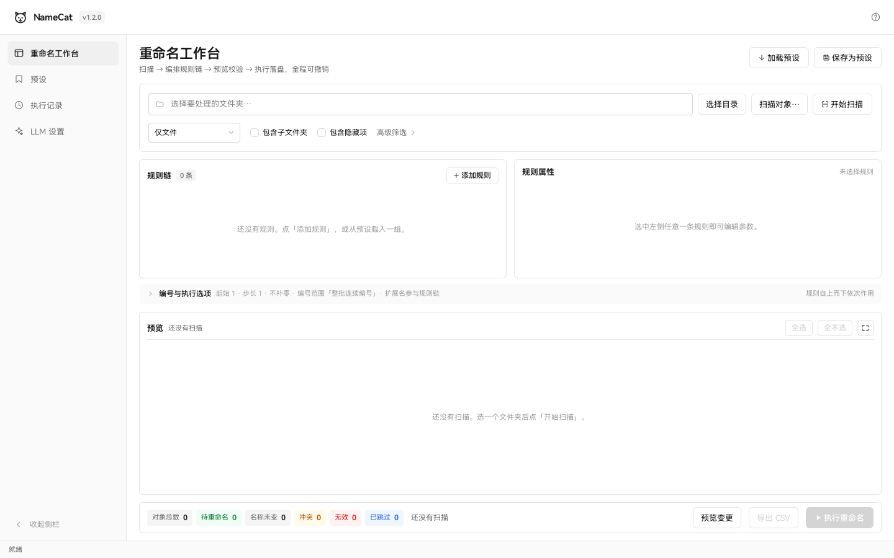

# FileCat

FileCat 是 Windows 批量重命名与文件整理工具。扫描文件 / 文件夹 / 图片 / 视频，用一条可排序的规则链算出新名字，**先预览、再落盘、全程可撤销**。图形界面与命令行共用同一套引擎；引擎是 Rust 实现的 PyO3 扩展，界面基于 PySide6。



`v3.0.1` · Windows 10/11 64 位 · 引擎 Rust（Python 3.15 扩展） · 界面 PySide6 6.10

不想装 Python / Rust？Releases 里有免安装的 `FileCat.exe`，下载双击即用。

---

## 三个保证

1. **预览显示的名字就是落盘的名字** —— 执行时直接用已算好的计划，绝不重算（LLM 不会被请求两遍，随机规则不会跑偏）。
2. **冲突项跳过、绝不覆盖** —— 批内重名、盘上占用、非法名字在校验阶段就标出来；落盘用 `MoveFileExW(flags=0)`，目标已存在时宁可直接失败也不覆盖。
3. **每一步都可撤销** —— 临时名中转处理链式改名与父子同时改名，任一步失败自动回滚；执行后写撤销日志，可整批还原。

---

## 功能

### 文件重命名

**扫描**

- 对象四类：文件 / 文件夹 / 图片 / 视频，可混合；图片、视频支持文件头魔数校验（扩展名骗不了它）
- 名称与扩展名过滤、只含 / 排除关键词；递归开关、隐藏项开关
- 排序十档：名称 / 时间 / 大小 / 路径，各有升降序；下拉就在预览卡表头，换档立即重扫；**先排序再编号**
- 直接拖入文件与文件夹；工具栏「选择目录…」选根目录，想「只要这几个文件」就把它们拖进预览卡
- 自动跳过日志目录（`Name_backup`、旧版 `_rename_logs`），不会把撤销日志当文件改名

**规则链**

- **28 种规则**，自上而下依次作用（顺序即语义），可启停、上下移动、复制、删除
- 每条规则可用「作用范围」限定到名字的某一段（某字符之前 / 之后、区间、第 N 次出现），并可勾选「不作用于扩展名」「保留分隔符」
- 六个分组：增删 / 切取 / 修饰 / 编号与序列 / 模板与规范化 / 智能
- 编号（起始值 / 步长 / 补零 / 编号范围 / 倒序 / 插入位置与锚点）全在「编号」一条里，链上没有第二个编号入口
- 「音视频文件序列化」把整名换成四位序号（每个文件夹各自从 0001 起、扩展名不变）
- 模板变量 `{n}` `{n:03}` `{name}` `{stem}` `{ext}` `{parent}` `{index}` `{total}` `{size}` `{mtime}` `{now}`，四种写法（`{var}` / `#Var#` / `%var%` / `$Var(...)`）都认
- 简繁转换内置 4000+ 汉字映射，方向可选

**校验与落盘**

- 两遍校验：名字语法（非法字符 / 保留名 / 尾点尾空格 / 超长 / 空主干）→ 批内重名 + 盘上占用
- 状态五档：待重命名 / 名称未变 / 冲突 / 无效 / 已跳过，原因写在行里
- 临时名中转：`A→B、B→C` 这类链式改名与父子目录同时改名都能正确落地；失败按日志回滚
- 撤销按日志逐条还原（**父目录先还原**，多层嵌套也能完整复原），目标已存在时跳过不覆盖

**预设**

- 内置 4 个常用预设；自定义预设存为 JSON（不含路径与密钥）
- 一键应用：规则链 + 扫描选项 + 编号选项一起套用，命令行与界面同解

### 文件提取

独立 Rust 引擎驱动的「文件提取」页：递归扫描 → 预览 → 模拟 / 执行 → 撤销。

- 一次到底 / 逐级上移、扫描深度、三种同名策略、排除规则、空目录清理、停止、CSV（UTF-8 BOM）
- 覆盖策略整条链路可用：计划生成（只读）不受确认位限制，危险确认只在真实写盘时校验；多源同目标时只允许第一个源覆盖，其余自动改名，撤销可完整还原
- 撤销日志固定在 `<程序目录>\Extract\Rollback_Log\`，含 `rollback_*.json` 与 `backups\`，与重命名的 `Name_backup` 完全隔离
- 执行记录页同时列出重命名与文件提取两类记录，按类型徽章区分，各自独立撤销

### LLM 智能精简（可选）

- 把 `IMG_20240601_拷贝(2)` 这类名字精简成可读短语；离线 / 没配密钥时自动跳过，其余规则照常工作
- 整批一次请求，结果缓存复用；请求失败只进「提示」，不会中断整批

---

## 界面

| 工作台 | 预设 |
|---|---|
|  |  |
| **执行记录** | **供应商配置** |
|  |  |

四个页面：**文件重命名**（扫描 → 规则链 → 预览 → 执行）、**文件提取**（递归扫描 → 预览 → 模拟/执行 → 撤销）、**执行记录**（两类记录各自撤销）、**供应商配置**（LLM 接入）。预设不再是独立页面，点文件重命名页的「加载预设」弹出选择/编辑窗口。

工作台右上角的 ⤢ 把预览表放大到整页（`Esc` 还原）；规则多时列表在卡内滚动。

| 快捷键 | 动作 |
|---|---|
| `F5` | 重新扫描 |
| `Ctrl+Enter` | 按当前规则生成预览 |
| `Ctrl+1…4` | 切换四个页面 |
| `Esc` | 退出预览表的放大（⤢）视图 |

勾选预览行点左侧复选框；删除规则用规则行右侧的删除按钮。

---

## 安装与运行

### 方式一：绿色版（推荐，不需要 Python）

1. 从 Releases 下载 `FileCat.exe`，保存到任意目录；
2. 双击运行（无需解压、无需安装 Python）。

单文件 exe 首次启动要解包约 30 MB 到 `%TEMP%`，比后续启动慢一两秒；被 SmartScreen 拦截时选「更多信息」→「仍要运行」。

### 方式二：从源码运行

需要 **Python 3.15**（扩展按这个版本编译）、**Rust 工具链** 与 `maturin`：

```bat
py -3 -m pip install -r requirements.txt
py -3 -m pip install maturin
py -3 rust_build.py          :: 构建引擎扩展，装进 _vendor\
FileCat.vbs                 :: 双击启动（无控制台）
FileCat.bat                 :: 带控制台启动，报错直接可见
python main.py              :: 等价写法
```

- 引擎实现全在 `crates/`，`engine/` 只是应用层（常量、命令行、LLM 批处理桥）。改 `crates/` 必须重跑 `rust_build.py`；只改 `ui/`、`adapters/` 不用。
- 界面字体用系统自带 UI 字体（Microsoft YaHei UI 等），不随包分发字体文件。
- 没构建引擎就启动，会直接提示 `引擎扩展没加载 … py -3 rust_build.py`（不是一句 `No module named`）。

### 常见问题

| 现象 | 原因与处理 |
|---|---|
| 双击 exe 弹出 **`Could not create temporary directory!`** | 当前账号的 `%TEMP%` 不可写（企业策略 / 安全软件锁住 / 用别的账号运行）。`set TEMP=%LOCALAPPDATA%\Temp` 后重新启动 |
| 双击没反应 | 看 `%TEMP%\FileCat_startup_error.log`；或改用 `FileCat.bat` 启动，能直接看到 traceback |
| 提示「引擎扩展没加载」 | 源码运行前忘了 `py -3 rust_build.py`；或 Python 版本与 `.pyd` 的 `cp315` 不一致 |
| LLM 规则没生效 | 左下角气泡看状态；没有可用客户端时规则会原样放行并在提示里说明原因 |

---

## 命令行

```bat
:: 预览（默认不落盘）
python main.py preview D:\照片 --rule "template={n}" --width 3 --only image --recursive

:: 真正改名（写撤销日志）
python main.py rename D:\照片 --rule "case=lower" --rule "remove-after=-" --apply

:: 用预设改名 / 撤销 / 查规则与预设 / 找中断残留
python main.py rename D:\照片 --preset "照片序号（四位）" --apply
python main.py undo D:\照片
python main.py rules
python main.py presets
python main.py leftovers D:\照片
```

| 子命令 | 作用 |
|---|---|
| `rename` | 算名并（可选）落盘；默认只预览 |
| `preview` | 只看结果，**不接受 `--apply`**（不会误改文件） |
| `undo` | 按日志撤销；`--list` 列出日志，`--log` 指定某一份 |
| `leftovers` | 列出执行被中断后遗留的 `__nk_tmp_*` 文件（有残留时返回 1） |
| `rules` | 列出全部 28 种规则及参数说明 |
| `presets` | 列出内置预设 |

常用参数：

- `--only`：`file / dir / image / video / media / all`（默认 `file`）
- `--rule 名称=参数1=参数2`，可重复，按顺序生效；`--rule "case=lower;sel=after;sep=-"` 限定作用范围
- `--preset <名称或文件>`：规则 + 扫描 + 编号选项一起套用，命令行显式参数优先
- `--sort`（10 种）、`--recursive`、`--hidden`、`--only-match`、`--exclude-match`、`--verify`（校验文件头）
- `--csv <路径>`：导出预览结果；`--limit`：只处理前 N 项
- `--start/--width/--step/--scope`：仅在规则链里没有编号规则时作为兜底
- `--apply` 才落盘；`--quiet` 关掉进度输出；退出码非 0 表示有失败项，脚本可直接判断
- LLM：`--llm-instruction <文件>`、`--llm-edit`（编辑要求文件）、`--llm-provider/--llm-model/--llm-batch`

---

## 撤销与日志

```
扫描 ──► 排序编号 ──► 规则链算名 ──► 两遍校验 ──► 预览 ──► 执行 ──► 撤销日志
```

- 日志统一放 **`<程序目录>\Name_backup\`**，不写进被改名的目录（不会污染你的数据）；程序目录不可写时退回 `%APPDATA%\FileCat\Name_backup`，`NAMECAT_LOG_DIR` 可强制指定。
- 文件名带 8 位目录指纹（`rename_<指纹>_<日期>_<时分秒>_<随机>.json`），各目录的日志混放也能分开查、分开清。
- 保留策略：每个目录最近 20 份，总量上限 200。
- 旧版本留在目标目录 `_rename_logs\` 的日志仍可读（只读兼容）。

---

## LLM 接入

在「供应商配置」页配置，或在规则链里加一条「LLM 智能精简」：

- **协议**：OpenAI Chat Completions / OpenAI Responses / Anthropic Messages
- **预设**：自定义 / OpenAI / DeepSeek / Xiaomi MiMo / OpenCode Go / 本地 Ollama / 离线替身
- **模型**：手动添加，或「获取模型列表」从接口拉一份存到本地
- **高级**：模型列表 URL、自定义请求头（随每次请求发出）
- **测试连接**：真发一个请求验证地址 / 密钥 / 模型，报耗时与失败原因（401 / 404 / 连不上都说人话）

密钥**不回显**，单独存 `%APPDATA%\FileCat\llm_credential.dat`（Windows DPAPI 加密，只有当前账号解得开）；地址、模型等非敏感项存 `llm_provider.json`。输入框留空表示沿用已保存的密钥。

整理要求在 `%APPDATA%\FileCat\llm_instruction.txt` 里自由编辑（同页右侧），`#` 开头是注释、不会发给模型。左下角气泡显示真实连接状态与平均耗时；测试连接与拉模型列表都在后台线程跑，不卡界面。

命令行也认环境变量（界面保存过配置时以界面为准，命令行参数优先级最高）：

```bat
set NAMECAT_LLM_API_KEY=sk-...
set NAMECAT_LLM_BASE_URL=https://api.deepseek.com
set NAMECAT_LLM_MODEL=deepseek-chat
```

也认 `OPENAI_API_KEY` / `DEEPSEEK_API_KEY`。

---

## 数据与隐私

| 位置 | 内容 |
|---|---|
| `%APPDATA%\FileCat\` | 界面偏好、自定义预设（**不含任何密钥**） |
| `%APPDATA%\FileCat\llm_provider.json` | LLM 地址 / 模型 / 请求头 |
| `%APPDATA%\FileCat\llm_credential.dat` | LLM 密钥（DPAPI 加密） |
| `<程序目录>\Name_backup\` | 重命名撤销日志（含本机真实路径） |
| `<程序目录>\Extract\Rollback_Log\` | 文件提取撤销日志与覆盖备份（含本机真实路径） |

预设与撤销日志都不含密钥；`Name_backup/`、`Extract/`、`gui_state.json` 已列入 `.gitignore`，不会进仓库。

---

## 工程结构

```
main.py                    入口：无参数开界面，其余走命令行
crates/
  namecat-core/            纯 Rust 引擎：规则链、模板、扫描、算名、校验、落盘、撤销、LLM、预设
                            不依赖 Python，可单独 cargo test
  namecat-py/              PyO3 绑定：把 core 包成 namecat_py 扩展（12 个子模块 + 根常量）
  namecat-extract-core/    文件提取引擎（纯 Rust，独立，可单独 cargo test）
engine/                    应用层（Python）
  __init__.py                应用名 / 版本 / 状态文案 / appdata 路径
  cli.py                     命令行全部逻辑（含 GBK 符号降级）
  llm_resolve.py             LLM 规则的「批量问一次模型」桥（由 Rust 侧的 plan 回调）
ui/                        PySide6 界面：base.py 设计令牌与公共 StatusSlot，pages/ 四个页面 + 预设对话框
adapters/engine_adapter.py  界面 ⇄ 重命名引擎的唯一通道（FormState ⇄ 引擎参数）
adapters/extract_adapter.py 界面 ⇄ 文件提取引擎的唯一通道（独立 FormState/Bundle）
workers/                   后台任务（QRunnable + 线程池，信号回主线程）
rust_build.py              构建引擎：校验版本一致 → maturin → 装 .pyd 进 _vendor
build_exe.py               打包：三道闸 + 生成 spec 瘦身 + 打包后自检
verify/                    自检与基准
tools/                     数据生成（简繁表、路径语义语料）
docs/                      设计文档、测试报告、交接文档、截图
```

**分层约定**：`ui/` 只调 `adapters/engine_adapter`，不直接碰引擎；界面与命令行共用同一份 Rust 实现，所以行为永远一致。改界面前先读 `docs/GUI_DESIGN_GUIDE.md`。

---

## 开发与验收

```bat
py -3 rust_build.py                        :: 构建引擎（改 crates/ 之后必跑）
py -3 verify\rust_check.py --fail-on-any   :: 符号闸门：12 个模块 / 193 个公开符号
py -3 verify\run_tests.py                  :: 引擎 + 端到端 + 回归（410 断言）
py -3 verify\test_edges.py                 :: 边界与异常路径（190 断言 + 16 个缺陷探针）
py -3 verify\ui_smoke.py                   :: 界面全流程冒烟（离屏，无需显示器）
py -3 verify\bench.py                       :: 性能基准（2000 文件，7 轮中位数）
py -3 build_exe.py                          :: 打包 + 自检（产出 dist/FileCat.exe）
```

- `rust_check.py` 拿 `verify/engine_symbols.json`（Rust 化前固化的期望集）比对扩展导出，少一个符号就红。
- `bench.py` 里带参考基准值，只能看量级 —— 严谨对比要在同一时段背靠背跑两版。
- 版本号唯一来源：`engine/__init__.py` 的 `APP_VER` 与 `Cargo.toml` 必须一致，`rust_build.py` 会校验。

**当前验证状态**：`cargo test --workspace` 145 项全过；`run_tests.py` 410 / 0；`test_edges.py` 190 / 0；`rust_check.py` 193 符号；四套离屏 GUI 冒烟全过。

---

## 已知限制

- 单文件 exe 每次启动都要解包自身，冷启动比源码运行慢；`%TEMP%` 不可写时无法启动（见「常见问题」）。
- 只支持 Windows：落盘用 `MoveFileExW`、大小写规范化用 `LCMapStringEx`、密钥用 DPAPI，没有跨平台分支。
- 撤销日志与预设是 JSON，手工改坏会按「能救的救、救不了的跳过」处理，不会崩，但也不保证还原出你想要的。
- LLM 精简需要网络与密钥；离线时该规则自动放行，不会拖住其余规则。

---

FileCat 3.0.1 · 引擎 Rust · 界面基于 PySide6 6.10 · 设计稿见 `docs/design-preview/boards.png`
