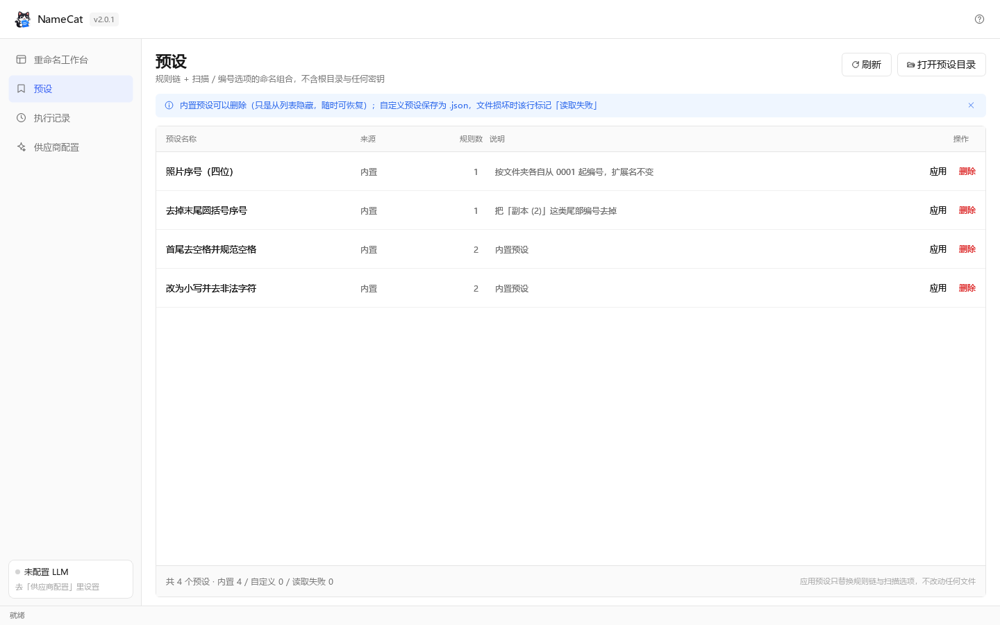

# FileCat

Windows 批量重命名工具。扫描文件 / 文件夹 / 图片 / 视频，用一条可排序的规则链算出新名字，**先预览、再落盘、全程可撤销**。

PySide6 桌面界面 + 可脚本化命令行，共用同一套引擎；引擎是 **Rust 写的**（PyO3 扩展），界面与命令行不会有第二套实现。


`v3.0.1` · Windows 10/11 64 位 · 引擎 Rust（Python 3.15 扩展） · 界面 PySide6 6.10

不想装 Python / Rust？Releases 里有免安装的 `FileCat.exe`，下载双击即用。

---

## 三个保证

1. **预览显示的名字就是落盘的名字** —— 执行时直接用已算好的计划，绝不重算（LLM 不会被请求两遍，随机规则不会跑偏）。
2. **冲突项跳过、绝不覆盖** —— 批内重名、盘上占用、非法名字在校验阶段就标出来；落盘用 `MoveFileExW(flags=0)`，目标已存在时宁可直接失败也不覆盖。
3. **每一步都可撤销** —— 临时名中转处理链式改名与父子同时改名，任一步失败自动回滚；执行后写撤销日志，可整批还原。

## 功能

### 扫描

- 对象四类：文件 / 文件夹 / 图片 / 视频，可混合；图片、视频支持文件头魔数校验（扩展名骗不了它）
- 名称与扩展名过滤、只含 / 排除关键词；递归开关、隐藏项开关
- 排序十档：名称 / 时间 / 大小 / 路径，各有升降序；下拉就在预览卡表头，换档立即重扫；**先排序再编号**
- 直接拖入文件与文件夹；工具栏「选择目录…」选根目录，想「只要这几个文件」就把它们拖进预览卡
- 自动跳过日志目录（`Name_backup`、旧版 `_rename_logs`），不会把撤销日志当文件改名

### 规则链

- **28 种规则**，自上而下依次作用（顺序即语义），可启停、上下移动、复制、删除
- 每条规则可用「作用范围」限定到名字的某一段（某字符之前 / 之后、区间、第 N 次出现），并可勾选「不作用于扩展名」「保留分隔符」
- 六个分组：增删 / 切取 / 修饰 / 编号与序列 / 模板与规范化 / 智能
- 编号（起始值 / 步长 / 补零 / 编号范围 / 倒序 / 插入位置与锚点）全在「编号」一条里，链上没有第二个编号入口
- 「音视频文件序列化」把整名换成四位序号（每个文件夹各自从 0001 起、扩展名不变）
- 模板变量 `{n}` `{n:03}` `{name}` `{stem}` `{ext}` `{parent}` `{index}` `{total}` `{size}` `{mtime}` `{now}`，四种写法（`{var}` / `#Var#` / `%var%` / `$Var(...)`）都认
- 简繁转换内置 4000+ 汉字映射，方向可选

### 校验与落盘

- 两遍校验：名字语法（非法字符 / 保留名 / 尾点尾空格 / 超长 / 空主干）→ 批内重名 + 盘上占用
- 状态五档：待重命名 / 名称未变 / 冲突 / 无效 / 已跳过，原因写在行里
- 临时名中转：`A→B、B→C` 这类链式改名与父子目录同时改名都能正确落地；失败按日志回滚
- 撤销按日志逐条还原（**父目录先还原**，多层嵌套也能完整复原），目标已存在时跳过不覆盖

### 预设

- 内置 4 个常用预设；自定义预设存为 JSON（不含路径与密钥）
- 一键应用：**规则链 + 扫描选项 + 编号选项一起套用**，命令行与界面同解

### LLM 智能精简（可选）

- 把 `IMG_20240601_拷贝(2)` 这类名字精简成可读短语；离线 / 没配密钥时自动跳过，其余规则照常工作
- 整批一次请求，结果缓存复用；请求失败只进"提示"，不会中断整批

## 界面

| 工作台 | 预设 |
|---|---|
|  |  |
| **执行记录** | **供应商配置** |
|  |  |

四个页面：**文件重命名**（扫描 → 规则链 → 预览 → 执行）、**文件提取**（递归扫描 → 预览 → 模拟/执行 → 撤销，独立 Rust 引擎）、**执行记录**（同时列出重命名与文件提取两类记录，各自撤销）、**供应商配置**（LLM 接入）。预设不再是独立页面，点文件重命名页的「加载预设」弹出选择/编辑窗口。

文件提取页的撤销日志固定在 **`<程序目录>\Extract\Rollback_Log\`**，含 `rollback_*.json` 与 `backups\`；与重命名的 `Name_backup` 完全隔离。

工作台右上角的 ⤢ 把预览表放大到整页（`Esc` 还原）；规则多时列表在卡内滚动。

| 快捷键 | 动作 |
|---|---|
| `F5` | 重新扫描 |
| `Ctrl+Enter` | 按当前规则生成预览 |
| `Ctrl+1…4` | 切换四个页面 |
| `Esc` | 退出预览表的放大（⤢）视图 |

勾选预览行点左侧复选框；删除规则用规则行右侧的删除按钮。

## 安装与运行

### 方式一：绿色版（推荐，不需要 Python）

1. 从 Releases 下载 `FileCat.exe`，保存到任意目录；
2. 双击运行（无需解压、无需安装 Python）。

单文件 exe 首次启动要解包约 30 MB 到 `%TEMP%`，比后续启动慢一两秒；被 SmartScreen 拦截时选「更多信息」→「仍要运行」。

### 方式二：从源码运行

需要 **Python 3.15**（扩展按这个版本编译）、**Rust 工具链** 与 `maturin`：

```bat
py -3 -m pip install -r requirements.txt
py -3 -m pip install maturin
py -3 rust_build.py          :: 构建引擎扩展，装进 _vendor\
FileCat.vbs                 :: 双击启动（无控制台）
FileCat.bat                 :: 带控制台启动，报错直接可见
python main.py              :: 等价写法
```

- 引擎实现全在 `crates/`，`engine/` 只是应用层（常量、命令行、LLM 批处理桥）。改 `crates/` 必须重跑 `rust_build.py`；只改 `ui/`、`adapters/` 不用。
- 界面字体用**系统自带 UI 字体**（Microsoft YaHei UI 等），不随包分发字体文件。
- 没构建引擎就启动，会直接提示 `引擎扩展没加载 … py -3 rust_build.py`（不是一句 `No module named`）。

### 常见问题

| 现象 | 原因与处理 |
|---|---|
| 双击 exe 弹出 **`Could not create temporary directory!`** | 当前账号的 `%TEMP%` 不可写（企业策略 / 安全软件锁住 / 用别的账号运行）。`set TEMP=%LOCALAPPDATA%\Temp` 后重新启动 |
| 双击没反应 | 看 `%TEMP%\FileCat_startup_error.log`；或改用 `FileCat.bat` 启动，能直接看到 traceback |
| 提示「引擎扩展没加载」 | 源码运行前忘了 `py -3 rust_build.py`；或 Python 版本与 `.pyd` 的 `cp315` 不一致 |
| LLM 规则没生效 | 左下角气泡看状态；没有可用客户端时规则会原样放行并在提示里说明原因 |

## 命令行

```bat
:: 预览（默认不落盘）
python main.py preview D:\照片 --rule "template={n}" --width 3 --only image --recursive

:: 真正改名（写撤销日志）
python main.py rename D:\照片 --rule "case=lower" --rule "remove-after=-" --apply

:: 用预设改名 / 撤销 / 查规则与预设 / 找中断残留
python main.py rename D:\照片 --preset "照片序号（四位）" --apply
python main.py undo D:\照片
python main.py rules
python main.py presets
python main.py leftovers D:\照片
```

| 子命令 | 作用 |
|---|---|
| `rename` | 算名并（可选）落盘；默认只预览 |
| `preview` | 只看结果，**不接受 `--apply`**（不会误改文件） |
| `undo` | 按日志撤销；`--list` 列出日志，`--log` 指定某一份 |
| `leftovers` | 列出执行被中断后遗留的 `__nk_tmp_*` 文件（有残留时返回 1） |
| `rules` | 列出全部 28 种规则及参数说明 |
| `presets` | 列出内置预设 |

常用参数：

- `--only`：`file / dir / image / video / media / all`（默认 `file`）
- `--rule 名称=参数1=参数2`，可重复，按顺序生效；`--rule "case=lower;sel=after;sep=-"` 限定作用范围
- `--preset <名称或文件>`：规则 + 扫描 + 编号选项一起套用，命令行显式参数优先
- `--sort`（10 种）、`--recursive`、`--hidden`、`--only-match`、`--exclude-match`、`--verify`（校验文件头）
- `--csv <路径>`：导出预览结果；`--limit`：只处理前 N 项
- `--start/--width/--step/--scope`：仅在规则链里没有编号规则时作为兜底
- `--apply` 才落盘；`--quiet` 关掉进度输出；退出码非 0 表示有失败项，脚本可直接判断
- LLM：`--llm-instruction <文件>`、`--llm-edit`（编辑要求文件）、`--llm-provider/--llm-model/--llm-batch`

## 撤销与日志

```
扫描 ──► 排序编号 ──► 规则链算名 ──► 两遍校验 ──► 预览 ──► 执行 ──► 撤销日志
```

- 日志统一放 **`<程序目录>\Name_backup\`**，不写进被改名的目录（不会污染你的数据）；程序目录不可写时退回 `%APPDATA%\FileCat\Name_backup`，`NAMECAT_LOG_DIR` 可强制指定。
- 文件名带 8 位目录指纹（`rename_<指纹>_<日期>_<时分秒>_<随机>.json`），各目录的日志混放也能分开查、分开清。
- 保留策略：每个目录最近 20 份，总量上限 200。
- 旧版本留在目标目录 `_rename_logs\` 的日志仍可读（只读兼容）。

## LLM 接入

在「供应商配置」页配置，或在规则链里加一条「LLM 智能精简」：

- **协议**：OpenAI Chat Completions / OpenAI Responses / Anthropic Messages
- **预设**：自定义 / OpenAI / DeepSeek / Xiaomi MiMo / OpenCode Go / 本地 Ollama / 离线替身
- **模型**：手动添加，或「获取模型列表」从接口拉一份存到本地
- **高级**：模型列表 URL、自定义请求头（随每次请求发出）
- **测试连接**：真发一个请求验证地址 / 密钥 / 模型，报耗时与失败原因（401 / 404 / 连不上都说人话）

密钥**不回显**，单独存 `%APPDATA%\FileCat\llm_credential.dat`（Windows DPAPI 加密，只有当前账号解得开）；地址、模型等非敏感项存 `llm_provider.json`。输入框留空表示沿用已保存的密钥。

整理要求在 `%APPDATA%\FileCat\llm_instruction.txt` 里自由编辑（同页右侧），`#` 开头是注释、不会发给模型。左下角气泡显示真实连接状态与平均耗时；测试连接与拉模型列表都在后台线程跑，不卡界面。

命令行也认环境变量（界面保存过配置时以界面为准，命令行参数优先级最高）：

```bat
set NAMECAT_LLM_API_KEY=sk-...
set NAMECAT_LLM_BASE_URL=https://api.deepseek.com
set NAMECAT_LLM_MODEL=deepseek-chat
```

也认 `OPENAI_API_KEY` / `DEEPSEEK_API_KEY`。

## 数据与隐私

| 位置 | 内容 |
|---|---|
| `%APPDATA%\FileCat\` | 界面偏好、自定义预设（**不含任何密钥**） |
| `%APPDATA%\FileCat\llm_provider.json` | LLM 地址 / 模型 / 请求头 |
| `%APPDATA%\FileCat\llm_credential.dat` | LLM 密钥（DPAPI 加密） |
| `<程序目录>\Name_backup\` | 重命名撤销日志（含本机真实路径） |
| `<程序目录>\Extract\Rollback_Log\` | 文件提取撤销日志与覆盖备份（含本机真实路径） |

预设与撤销日志都不含密钥；`Name_backup/`、`Extract/`、`gui_state.json` 已列入 `.gitignore`，不会进仓库。

## 工程结构

```
main.py                    入口：无参数开界面，其余走命令行
crates/
  namecat-core/            纯 Rust 引擎：规则链、模板、扫描、算名、校验、落盘、撤销、LLM、预设
                            不依赖 Python，可单独 cargo test
  namecat-py/              PyO3 绑定：把 core 包成 namecat_py 扩展（12 个子模块 + 根常量）
engine/                    应用层（Python）
  __init__.py                应用名 / 版本 / 状态文案 / appdata 与旧目录迁移
  cli.py                     命令行全部逻辑（含 GBK 符号降级）
  llm_resolve.py             LLM 规则的"批量问一次模型"桥（由 Rust 侧的 plan 回调）
ui/                        PySide6 界面：base.py 设计令牌与公共 StatusSlot，pages/ 四个页面 + 预设对话框
adapters/engine_adapter.py 界面 ⇄ 重命名引擎的唯一通道（FormState ⇄ 引擎参数）
adapters/extract_adapter.py 界面 ⇄ 文件提取引擎的唯一通道（独立 FormState/Bundle）
crates/namecat-extract-core/ 文件提取引擎（纯 Rust，独立，可单独 cargo test）
workers/                   后台任务（QRunnable + 线程池，信号回主线程）
rust_build.py              构建引擎：校验版本一致 → maturin → 装 .pyd 进 _vendor
build_exe.py               打包：三道闸 + 生成 spec 瘦身 + 打包后自检
verify/                    自检与基准
tools/                     数据生成（简繁表、路径语义语料）
docs/                      设计文档、测试报告、交接文档、截图
```

**分层约定**：`ui/` 只调 `adapters.engine_adapter`，不直接碰引擎；引擎是 Rust 扩展，界面与命令行共用同一份实现，所以行为永远一致。改界面前先读 `docs/GUI_DESIGN_GUIDE.md`。

## 开发与验收

```bat
py -3 rust_build.py                        :: 构建引擎（改 crates/ 之后必跑）
py -3 verify\rust_check.py --fail-on-any   :: 符号闸门：12 个模块 / 193 个公开符号
py -3 verify\run_tests.py                  :: 引擎 + 端到端 + 回归（410 断言）
py -3 verify\test_edges.py                 :: 边界与异常路径（190 断言 + 16 个缺陷探针）
py -3 verify\ui_smoke.py                   :: 界面全流程冒烟（离屏，无需显示器）
py -3 verify\bench.py                       :: 性能基准（2000 文件，7 轮中位数）
py -3 build_exe.py                          :: 打包 + 自检（产出 dist/FileCat.exe）
py -3 build_exe.py --zip                    :: 额外压成 zip（本版起 Release 默认直发 EXE）
```

- `rust_check.py` 拿 `verify/engine_symbols.json`（Rust 化之前固化的期望集）比对扩展导出，少一个符号就红。
- `bench.py` 里带 1.6.3 的参考值，只能看量级 —— 严谨对比要在同一时段背靠背跑两版。
- 发版流程：改 `engine/__init__.py` 的 `APP_VER` 与 `Cargo.toml` 版本（必须一致，`rust_build.py` 会校验）→ 重建 → 跑上面几条 → `build_exe.py`（不加 `--zip`，直接拿 `dist/FileCat.exe`）→ commit + `git tag -a vX.Y.Z` → push → `gh release create … dist/FileCat.exe`。

### 性能（2000 个文件，迁移时背靠背 A/B）

| 阶段 | 1.6.3（Python 引擎） | 2.0.x（Rust 引擎） | 倍率 |
|---|---|---|---|
| 扫描 | 50.2 ms | 30.5 ms | 1.65× |
| 纯算名 | 27.1 ms | 22.4 ms | 1.21× |
| 扫描 + 算名 | 136.9 ms | 116.1 ms | 1.18× |
| 算名 + 两遍校验 | 80.1 ms | 83.0 ms | 持平（探盘与大小写规范化主导） |
| 落盘 / 撤销 | 611 / 1133 ms | 621 / 1232 ms | 持平（磁盘 I/O 主导） |

## 已知限制

- 单文件 exe 每次启动都要解包自身，冷启动比源码运行慢；`%TEMP%` 不可写时无法启动（见「常见问题」）。
- 只支持 Windows：落盘用 `MoveFileExW`、大小写规范化用 `LCMapStringEx`、密钥用 DPAPI，没有跨平台分支。
- 撤销日志与预设是 JSON，手工改坏会按"能救的救、救不了的跳过"处理，不会崩，但也不保证还原出你想要的。
- LLM 精简需要网络与密钥；离线时该规则自动放行，不会拖住其余规则。

## 更新记录

### 3.0.1

**文件提取引擎审计后的缺陷修复与性能治理。** 对 3.0.0 新增的 `namecat-extract-core` 与提取页做了逐文件审查、实证复现并修复，新增 8 组回归测试。

- **覆盖策略整条链路可用**：计划生成（只读）不再因「尚未确认覆盖」被拒绝；危险确认只在真实写盘时校验，模拟运行不受限；确认位在配置变动 / 重扫 / 执行收尾一律复位，杜绝残留导致的静默覆盖。
- **多源同目标覆盖不再丢数据**：同一目标只允许第一个源覆盖，其余自动改名；撤销可完整还原原文件与全部子目录源文件（实测 OLD / ONE / TWO 三方归位）。
- **撤销可靠性**：真实执行后计划即消费，拒绝用旧计划重跑；0 条目空日志不再生成、不再挡住「撤销上次」；撤销日志改为逐条 append 检查点（崩溃最多丢最后一项），checkpoint 失败立即停止后续搬运；`list_logs` 纯只读，恢复只在撤销时落盘；部分失败跳过的条目保留在日志里供重入；覆盖撤销与 `replace_with_backup` 失败路径都加了回滚，不再出现目标永久空缺。
- **计划输入校验**：外部 JSON 计划必须满足 root 一致、source/target 在目标文件夹内、冲突策略一致、target≠source，杜绝伪造计划触发任意路径删除。
- **性能**：3000 文件执行从 8.97s 降到 3.27s（-63.6%）——去掉 `MOVEFILE_WRITE_THROUGH`、日志从 O(n²) 全量重写改为逐条追加且复用文件句柄、CSV 去掉整串双重替换、自动改名加磁盘探测与计数缓存、进度回调节流、日志读取释放 GIL。
- **GUI / 绑定层**：忙时冻结所有输入、`_busy` 单一防重入、`finished` 兜底防界面卡死、唯一 task_id 与停止按钮按阶段如实启用；`except BaseException` 兜住 PyO3 panic；进度回调异常不再静默吞；非 UTF-8 路径 lossy 序列化，避免「文件已搬完却拿不到日志路径」；撤销后历史页可靠刷新；筛选支持中文状态文案。
- **验证**：`cargo test --workspace` 145 项全过（含 8 组新增回归）、`run_tests.py` 410 / 0、`test_edges.py` 190 / 0、`rust_check.py` 193 符号、四套离屏 GUI 冒烟全过。

### 3.0.0

**程序更名 FileCat，新增「文件提取」页与独立 Rust 提取引擎。**

- 程序名由 NameCat 改为 **FileCat**；数据目录 `%APPDATA%\FileCat`（旧 `NameCat` / `NameKit` 配置自动迁移）。
- 新增 `crates/namecat-extract-core`：纯 Rust、零 PyO3/Qt 依赖，与原重命名 `namecat-core` 完全隔离；通过现有扩展挂成 `namecat_py.extract` 子模块，仍共用一份 `.pyd` 与同一套 EXE 打包链路。
- 新增第五个页面「文件提取」：一次到底 / 逐级上移、扫描深度、三种同名策略、排除规则、模拟运行、停止、空目录清理、撤销、CSV（UTF-8 BOM）。撤销日志固定在 `<程序目录>\Extract\Rollback_Log\`，与 `Name_backup` 隔离。
- 原「重命名工作台」更名为「文件重命名」；「包含子文件夹」默认打开、「清理空文件夹」默认打开。
- 文件提取清单改为原生 `QHeaderView`，表头与内容列同源对齐（修复初版手绘表头错位）。
- 文件重命名页工具栏加进度条；状态反馈抽成公共 `StatusSlot`，两页同款胶囊、不再有独立横幅。
- 「执行记录」同时列出重命名与文件提取两类日志，按类型徽章区分、各自独立撤销。
- 预设改为文件重命名页「加载预设」弹出的选择/编辑对话框；主窗口精简为四页。
- 扫描对象下拉恢复原样式，默认「图片 + 视频」，移除「文件 + 文件夹」同时扫描档（命令行 `--only all` 仍可用）。

### 2.1.1

**修复：执行重命名 / 撤销后预览没有及时更新**。落盘会改变磁盘上的名字，但工作台仍持有执行前的 `PlanBundle`，旧实现只把预览标成「配置已改动」，表格还显示改名前的清单；点「重新生成预览」又会拿旧 `Item` 重算，预览与磁盘脱节。现在执行 / 撤销完成后自动按磁盘现状重扫，重扫结束把执行结果贴回状态槽；清单失效期间禁止再次执行、导出和按旧清单算名。执行记录页的撤销走同一套刷新流程，`verify/ui_smoke.py` 补了「表格名字与磁盘一致」的执行 / 撤销回归断言。

新增 `AGENT.MD`：项目结构、分层、状态机、修改速查表与历史坑的维护手册。

### 2.1.0

**排序方式默认改为「路径（先目录后名称）」**：原来是「名称（自然序）」，递归扫描多层目录时发号顺序会把不同文件夹的同名文件交错在一起；按路径排更符合「先整理目录、再按名称」的直觉。界面下拉、命令行 `--sort`、内置预设与引擎默认值已统一，已有预设里显式存的排序档不受影响。

**大目录性能**：预览表改为自绘 + 只画可见行，9000 个图片文件从建表 259 秒降到 52 ms，勾选 / 全选 / 滚动回到毫秒级；扫描选中大量文件时的二次复杂度也一并修掉（详见 `docs/TEST_REPORT.md` 第 8.5 节）。

**发布形态**：本版起 Release 直接提供单个 `NameCat.exe`，不再附 zip 压缩包。

### 2.0.2

**修：全新安装时「整理要求」没有生成默认文件**。文档让人直接编辑
`%APPDATA%\FileCat\llm_instruction.txt`，但过去只有点过「保存要求」才会创建它 ——
照着文档去找的人会发现文件根本不存在。现在打开「供应商配置」页就会把内置默认要求
（4 行）落盘，用户改过了则原样保留、绝不覆盖。

如果你之前存过自己的工作要求，它一直在那个文件里，界面显示的也一直是它；
想让界面回到内置默认，点卡片上的「恢复默认」再点「保存要求」即可。

### 2.0.1

**去掉 Python 兼容层，引擎只剩一套接口**：

- **重构**：删除 `engine/` 下 12 个转发壳（`rules.py`、`scan.py`、`plan.py` 等），调用方一律直接 `from namecat_py.<模块> import …`。少一层间接，也就不存在"壳和实现对不上"的可能
- **修复（验证工具）**：`verify/run_tests.py` 原来把 `_verify_tmp/` 当自己的沙箱并在结束时整目录删除，会连带删掉放在同一目录下的其它验证资产；现在各套件用自己的目录（`_verify_run/`、`_verify_edges/`、`_verify_gui_tmp/`）
- **补齐**：`namecat_py.ops._common_base`（原 Python 私有辅助，自检直接断言"跨盘退回首项"）
- **整理**：基准脚本收编为 `verify/bench.py`（原先放在临时目录里，跑测试会被清掉）
- **文档**：README 按当前实现重写（安装、命令行、工程结构、验收命令、性能数据）

### 2.0.0

**引擎整体由 Python 改写为 Rust**（12 个模块，PyO3 扩展）。对外接口逐个保持不变，界面与命令行几乎没动 —— 2.0 的版本号是给引擎换的实现底座。

- **性能**：扫描 2000 个文件 50 → 30 ms（1.65×），"扫描 + 算名"整体 137 → 116 ms（1.18×）；算名、落盘、撤销与 Python 版持平
- **一致性**：迁移期用 3170 项逐字段对拍（参考实现取自 1.6.3 的 Python 引擎）确认行为逐项一致；另有符号闸门盯住 193 个公开符号
- **发布链路**：`build_exe.py` 三道闸（扩展是否存在 / ABI 是否匹配 / 是否比源码旧），打包后自动跑"改名 → 撤销"自检
- **体积**：exe 41.2 → 29.8 MB（剔除 `opengl32sw.dll` 等用不到的二进制；老机器需要软件 OpenGL 时用 `--keep-opengl` 打回去）
- **源码运行**：需要 Python 3.15，并先 `py -3 rust_build.py` 构建引擎

### 1.6.3

功能有效性与一致性审查后的修复，重点在「同一份配置在不同入口得到不同结果」：

- **修复（一致性）**：命令行 `--preset` 只读了规则、把预设里的扫描与编号选项丢掉了 —— 同一条内置预设在界面出 `0001.jpg`、在命令行出 `1.jpg`。现在两者同解（规则 + 扫描 + 编号一起套用），命令行显式参数优先
- **修复（数据安全）**：模板输出里带点时原扩展名会被吞掉（`template={parent}-{n}` 遇到父目录 `2024.10`，`photo.jpg` 变成 `2024.10-1`）。现在只有模板**原文**自己写了 `.md` 这类字面扩展名时才替换原扩展名
- **修复（数据安全）**：`A→B、B→C` 链式改名里若 B 的去向被盘上文件占住，A 仍判「待重命名」，执行必然失败（WinError 183）并把整批拖成「失败」。现在只把"确实会让位"的项算作腾出路径
- **修复（可达性）**：属性面板补上「不作用于扩展名」「第几次出现」「保留分隔符」三个开关；编号规则补「锚点字符」，选「锚点之前 / 之后」不再静默退回前缀
- **修复**：`extension` 填 `md`、`keep_after` 留空这类引擎本来就能处理的写法，不再被当成参数错误拦下，改为面板底部的橙色提示
- **修复**：取消勾选预览行后该行状态格不刷新（文字还写着"待重命名"，而底部"已跳过"已经 +1）
- **修复**：应用预设后「包含子文件夹 / 包含隐藏项」勾选框与预设不一致
- **修复**：LLM 请求失败时左下角气泡仍显示"已连接 · 平均 N ms"（状态上报写在 `finally` 里）
- **修复**：「执行记录」的结果列显示的是校验统计而非执行结果；日志新增 `exec` 段（schema 5）记录真实成败，老日志照常可读
- **修复**：`preview --apply` 真的会改名 —— 该子命令不再接受 `--apply`
- **改进**：模板输入框的 tooltip 列出全部可用变量与示例值
- **改进**：四条切取规则的「分隔符留空」统一为按长度对半截断
- **改进**：编辑靠后的规则时，规则列表不再跳回顶部
- **文档**：「音译」更名为「转写（转拉丁字母）」并注明中文不做拼音转换；README 去掉并不存在的「拖动排序」「预设导入导出」

### 1.6.2

全面测试（`docs/TEST_REPORT.md`）后的缺陷修复，**4 个 P0 全部修掉**：

- **修复（数据安全）**：链式改名在落位阶段失败时，已落位的文件会被留在 `__nk_tmp_*` 临时名下、原名丢失，界面还报"已回滚"。现在统一退回原名，失败原因也不再被"已回滚"覆盖
- **修复（数据安全）**：规则把名字主干删空时，原来会把 `abc.txt` 改成没有名字的 `.txt` 并真的落盘；现在判"无效：名字不能为空（只剩扩展名）"，文件夹删空也从"名称未变"改为明确的"规则把名字删空了"
- **修复**：作用范围选「到某字符止（含）」时改名结果错乱（`case=upper` 会把 `show-2026-10-19` 变成 `show-SHOW-`），根因是拼回时用了"某字符之后"的公式
- **修复**：从两个盘符各拖一个文件夹进来时，预览直接抛 `ValueError`；现在跨盘对象不做父路径映射，并且**只收拖进来的那几个**
- **修复**：撤销只成功一半后日志永远删不掉、每次撤销都报"未完成"。现在已不存在的目标算跳过、失败项写回日志、该做的做完即删，重复撤销幂等
- **修复**：撤销日志写不进去时仍然报"已重命名 N 项"成功 —— 现在明确提示"本次改名无法撤销"
- **修复**：`main.py undo --log` 指向不存在/损坏的日志时抛 traceback；`--csv` 指向不可写路径同样抛栈 —— 都改为一句人话 + 非 0 退出码
- **修复**：一份结构异常的日志会让「执行记录」整页读取失败（好日志也看不到）；现在只跳过那一份
- **修复**：应用预设会清空当前目录和已扫结果，现在保住目录并按新预设自动重扫
- **修复**：供应商配置页切走再切回会静默清掉刚粘贴、还没保存的密钥
- **修复**：`--step 0` 不再让整批拿到同一个号码（回落成 1 并提示）；补零宽度 / 随机串长度加上限（64）
- **修复**：本机装了系统代理时，`127.0.0.1` 的请求也会被塞给代理，本地 Ollama 报的错变成代理的 502 —— 现在回环地址一律绕过代理
- **修复**：`normalize()` 对 `extras=None`、`selector=3` 这类程序化脏输入会崩；未知规则类型现在会在界面上标出来
- **新增**：`main.py leftovers <目录>` 列出执行被中断后遗留的临时名文件（有残留时返回 1）
- **新增**：`verify/test_edges.py` —— 190 条边界与异常路径断言 + 16 个缺陷探针

### 1.6.0

- **新规则：简繁转换**（`zhconv`）—— 逐字转换 4000+ 汉字，方向可选「简体→繁体 / 繁体→简体」；命令行别名 `zh` / `s2t` / `t2s`。规则数 27 → 28
- **界面：去掉所有横幅**，页内提示统一并入工具栏右侧的状态槽，按语气给胶囊底色
- **界面：执行结果不再打印撤销日志路径**，要看 Log 去「执行记录」页
- **发布：Windows 单文件 exe**（`build_exe.py` 一键打包），Releases 直接下载，无需 Python 环境

### 1.5.2

- 修正 1.5.1 的「选择…」按钮：Qt 的文件对话框在 Windows 上无法同时选文件和文件夹，改回**只选文件夹**的「选择目录…」
- 「只要这几个文件」的用法改用拖放：把文件拖进预览卡即可

### 1.5.0

- **版本号统一**为 1.5.0：界面 / 命令行 / 预设元数据 / 撤销日志全部一致
- **修复**：扫描不再把 `Name_backup` 里的撤销日志当成改名对象
- **修复**：撤销失败会正确返回非 0，不再误报成功
- **修复**：手改坏的预设 JSON 不再抛异常，能读回来的规则照常使用
- **字体**：移除随包字体，改用系统自带 UI 字体；小字号不再加粗
- **LLM 供应商配置**：三种协议、七个预设、DPAPI 密钥保管、后台测连通

---

FileCat 3.0.1 · 引擎 Rust · 界面基于 PySide6 6.10 · 设计稿见 `docs/design-preview/boards.png`
